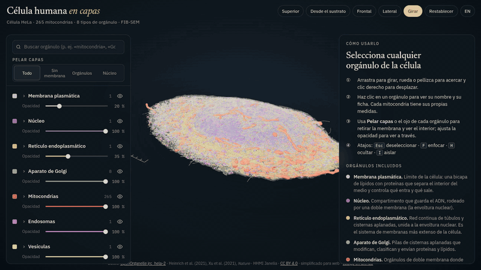

# Célula humana en capas (Layered Human Cell)

🇪🇸 [Versión en español](README.es.md)

Interactive 3D viewer of a real human cell (HeLa line) reconstructed by electron microscopy (FIB-SEM), for educational use. It shows the plasma membrane, nucleus, endoplasmic reticulum, Golgi apparatus, 265 mitochondria with their measurements, endosomes, vesicles and microtubules, with layers you can toggle, per-organelle opacity, search, and a description card for each structure. **Available in Spanish and English**: the language is picked from your browser and can be switched with the ES/EN button (or `?lang=en`). The English cards are a translation of the Spanish originals and have not been reviewed by specialists.



## Usage

**Try it online:** https://celula.alexisparron.com (the deployed version adds the site's analytics; the code in this repository contains no trackers).

1. Clone the repository, or download it as a zip and unpack it.
2. Open `index.html` in any modern browser (Chrome, Firefox, Edge, Safari).

It works offline and needs no installation. Fonts are bundled in `fonts/` (Newsreader and IBM Plex, SIL OFL 1.1), so no external server is contacted.

To modify the viewer, edit `src/visor.js` and regenerate `app.js`:

```
npm ci
npm run build
```

To publish it on the web, upload the folder as is to any static host (GitHub Pages, Netlify, Vercel…).

## Repository layout

| Path | What it is |
|---|---|
| `index.html` | Viewer page (structure and styles) |
| `src/visor.js` | **Source code** of the viewer (readable ES module) |
| `app.js` | The same code bundled with three.js, unminified (generated by `npm run build`) |
| `package.json`, `package-lock.json` | Dependencies and build command |
| `herramientas/` | Scripts that prepared the meshes and cards (see `herramientas/LEEME.md`, in Spanish) |
| `fonts/` | Local fonts with their OFL licenses |
| `src/i18n.js` | Interface texts per language |
| `data/anatomia.js` | Organelle cards, names and organization (Spanish base text) |
| `data/anatomia.en.js` | English translation layer of the cards (loaded on demand) |
| `models/*.js` | 3D meshes (meshoptimizer-compressed binary glTF, base64) |
| `LICENSE`, `LICENSE-codigo.txt` | MIT license for the code |
| `LICENSE-contenido.md` | License for the meshes and texts (CC BY 4.0) |
| `LICENSE-three.js.txt` | MIT license of three.js |

## Data source and credits

Dataset **jrc_hela-2** from OpenOrganelle (HHMI Janelia Research Campus, COSEM project): https://openorganelle.janelia.org/datasets/jrc_hela-2
- Segmentations: https://doi.org/10.25378/janelia.13108343 (CC BY 4.0)
- Heinrich L. et al. (2021). *Whole-cell organelle segmentation in volume electron microscopy.* Nature 599: 141–146. https://doi.org/10.1038/s41586-021-03977-3
- Xu C.S. et al. (2021). *An open-access volume electron microscopy atlas of whole cells and tissues.* Nature 599: 147–151. https://doi.org/10.1038/s41586-021-03992-4

**Changes made to the original data:**
- Intermediate levels of detail of the multiresolution meshes were used and simplified.
- Only the membrane, nucleus and organelles of the central cell were kept, separated by position.
- Mitochondria were measured on the simplified meshes.
- Conventional colors were assigned and Spanish description cards were written.

## Licenses

- **Code** (`index.html`, `src/`, `herramientas/` and `app.js`, except three.js): MIT. See `LICENSE-codigo.txt`.
- **Meshes and cards** (`models/`, `data/`): CC BY 4.0. See `LICENSE-contenido.md`. Attribution to Janelia/COSEM must be kept.
- **Fonts:** SIL Open Font License 1.1, see `fonts/`.

## Limitations

It does not include ribosomes, actin filaments, intermediate filaments, centrosome, nucleolus or nuclear pores, because they are not part of the published meshes of this dataset. Colors are conventional: electron microscopy has no color. **For educational use.** The cards have not been reviewed by specialists.

## A note on HeLa cells

HeLa cells come from a tumor of Henrietta Lacks, removed in 1951 without her consent. Since 2013 there is an agreement between her family and the NIH on the use of the genomic data of these cells. This viewer shows only the shape of the cell and contains no genetic information.

## Contributing

Corrections to cards, bug reports and improvements are welcome: see [CONTRIBUTING.md](CONTRIBUTING.md) and the [code of conduct](CODE_OF_CONDUCT.md). For vulnerabilities, see [SECURITY.md](SECURITY.md). To cite this work, use [CITATION.cff](CITATION.cff).

## Authorship

Viewer and cards: Alexis Parrón, 2026. Developed with the help of Claude (Anthropic).

3D library: [three.js](https://threejs.org) (MIT). Mesh compression: [meshoptimizer](https://github.com/zeux/meshoptimizer) (MIT, © Arseny Kapoulkine).
